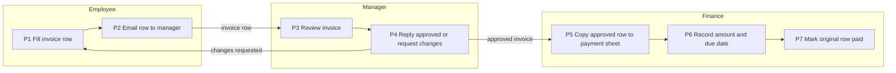
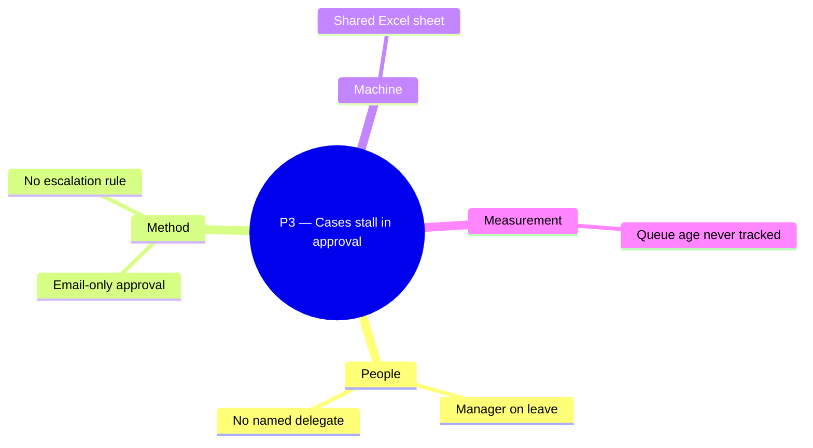

# Process analysis — SIPOC, swimlanes, pain points, root cause, gaps

Loaded for job 2 (analyze a business process). A process document describes how work
happens today and what should change; it does **not** design software. Number the steps
`P1`, `P2`… in plain prose and keep requirement IDs (`BR-nnn`, `FR-nnn`, `NFR-nnn`) out of
this document. When job 2 → 1 later writes requirements for the to-be, those requirements
live in their own file and cite process steps by `P` number.

## Process summary

State, in five lines or fewer: what the process produces, who triggers it, how often it
runs, how long a typical case takes, and what the requester wants changed. Every number
here must come from the input or be labelled as an assumption or open question using the
`A-nn` / `Q-nn` tables from `elicitation.md`.

## SIPOC — required table

Write the SIPOC before any diagram. It fixes the process boundary and names who supplies
and receives what.

| Suppliers | Inputs | Process | Outputs | Customers |
|---|---|---|---|---|
| <who provides each input> | <artifact or data that starts the work> | <P1 … Pn, one line> | <artifact or decision the process produces> | <who receives each output> |

Required parts:

- `Suppliers` names a role or system for **each** input, not "various".
- `Inputs` lists concrete artifacts (invoice row, approval email), not activities.
- `Process` is the ordered `P1 … Pn` list; the same numbers appear in the as-is map and
  the pain-point table.
- `Outputs` names what leaves the process (payment scheduled, invoice rejected).
- `Customers` names the receiving role, including internal ones (Finance, vendor, auditor).

A process document without a SIPOC table is incomplete.

## As-is map — required shape

The as-is map is **one** Mermaid `flowchart LR` with **one `subgraph` per role**. Role
lanes are the point: a reader must see which role performs each step and where work
crosses a lane.

An as-is map **is**:

1. Exactly one ` ```mermaid ` block whose first line is `flowchart LR`.
2. One `subgraph <id> ["<Role>"]` for every role that performs a step; `<id>` has no
   spaces, `<Role>` is the role name in quotes. Close each lane with `end`.
3. Every step `P1…Pn` placed **inside** its performer's lane as a node, label starting
   with the step number (`P1 Fill invoice row`).
4. A handoff drawn as an edge **between** lanes, labelled with what passes
   (`-->|invoice row|`).
5. Exception edges labelled as such (`-->|changes requested|`), returning to the step that
   reworks the case.
6. The same `P` numbers as the SIPOC and the pain-point table.

Worked example — invoice approval across three roles:



Keep the diagram readable on GitHub: quoted labels, ids without spaces, no styling
directives. If a role performs no step, it gets no lane; if a step has two performers,
split it into two numbered steps.

## Steps table — required columns

List every step behind the diagram so inputs, tools, and waiting are explicit.

| Step | Role | Activity | Input | Output | Tool / system | Wait time | Notes |
|---|---|---|---|---|---|---|---|
| P1 | <role> | <what they do> | <what arrives> | <what leaves> | <email, Excel, ERP> | <time or "unknown"> | <variation> |

Required parts: every `P` used in the map appears here exactly once; `Wait time` is filled
with an observed value or `unknown` (never blank); `Tool / system` names where the work
actually happens; an `unknown` wait time becomes an `A-nn` or `Q-nn` when it matters.

## Pain points — required step column

Every pain point names the step where it occurs. A pain point without a step cannot be
fixed, so the `Step` column is required and may hold several steps (`P3–P5`).

| Step | Pain | Type | Lean waste (DOWNTIME) | Evidence | Impact |
|---|---|---|---|---|---|
| P3 | Manager on leave, nothing moves | wait | Waiting | <input quote or observation> | <days lost per case> |
| P2 → P3 | Approval sits in one inbox | handoff | Transportation | <input quote> | <cases stalled per month> |
| P4 → P1 | Changes requested, row re-entered | rework | Defects | <input quote> | <rework frequency> |
| P3 | Single approver for every amount | approval | Extra-processing | <input quote> | <queue growth> |
| P5 | Approved rows copied by hand | manual re-entry | Defects | <input quote> | <keying error rate> |

Required parts:

- `Step` starts with a `P` number or `P` range and names where the pain occurs.
- `Type` is one of `wait`, `handoff`, `rework`, `approval`, `manual re-entry`.
- `Lean waste` is one of the eight DOWNTIME wastes: Defects, Over-production, Waiting,
  Non-utilised talent, Transportation, Inventory, Motion, Extra-processing.
- `Evidence` quotes the input or records the observation; no pain point is invented.
- `Impact` states a number, a time, or `unknown` (which becomes an `A-nn` or `Q-nn`).

Rank the pain points by impact and carry the top one into root-cause analysis.

## Root cause — 5 Whys

Use 5 Whys for the top-ranked pain point. Each answer must be a cause, not a restatement.

```
Pain: P3 — a case waits days whenever the manager is on leave.
1. Why does the case wait?           Because only the manager can approve.
2. Why can only the manager approve? Because approval rights are personal, not role-based.
3. Why are rights personal?          Because the email approval has no delegation rule.
4. Why is there no delegation rule?  Because the process was never written down.
5. Why was it never written down?    Because the process grew ad hoc around email.
Root cause: no written approval policy with a delegation path.
```

Required parts: the pain point with its `P` number; at least three Whys; a root cause that
is a condition, not a person; each Why traceable to evidence already in the document.

## Root cause — fishbone when causes branch

When causes branch across categories, draw a `mindmap` instead of a linear 5 Whys. Use the
6M categories that apply (People, Method, Machine, Material, Measurement, Environment).



Required parts: root node is the pain point with its `P` number in the text; every branch
is a cause observed in the input; delete categories with no causes rather than writing
"none".

## To-be map — required shape

The to-be map is a **proposal**, labelled as such, and it reuses the as-is swimlane recipe:
one `flowchart LR`, one `subgraph` per role, steps inside their role's lane, handoffs as
edges between lanes. Number the to-be steps `P1…Pn` (renumber if the sequence changes) so
each change can be traced to the step it replaces.

Required parts:

1. A heading or sentence that says this is a proposal, not an agreed design.
2. The same lane structure as the as-is map, so a reader can compare role by role.
3. A change table tying every change to the pain point it removes:

| To-be step | Change | As-is step replaced | Pain point addressed |
|---|---|---|---|
| P3 | Approval routes to a named delegate when the manager is away | P3 | P3 — manager on leave |

4. No software, vendor, or screen choice; describe the work and the handoff, not the tool.
5. Every change traces to a row in the pain-point table; a change with no pain point is
   dropped or recorded as an `A-nn`/`Q-nn`.

## Gap table

Summarize the distance between as-is and to-be. The standalone gap-analysis template
expands this table; the process doc keeps the short version.

| Area | As-is | To-be | Gap | Change needed |
|---|---|---|---|---|
| <step or capability> | <today> | <proposed> | <what is missing> | <action> |

Required parts: one row per changed area; `Gap` states the difference, not the solution;
`Change needed` is an action the business can take.

## Assumptions and open questions

Use the exact `A-nn` / `Q-nn` tables from `elicitation.md`; do not invent a parallel
register. A process document written in draft mode records every unknown here instead of
presenting it as fact.

| ID | Assumption | Basis in input, or impact if false |
|---|---|---|
| A-01 | <one testable statement the analysis relies on> | <input line, or what changes if false> |

| ID | Question | Owner | Blocks |
|---|---|---|---|
| Q-01 | <one answerable question> | <role or person who can answer> | <process step or gap it blocks> |

## Checklist before writing the document

- SIPOC table present with all five columns filled.
- As-is map: one `flowchart LR`, one lane per role, `P` numbers inside lanes, handoffs
  labelled between lanes.
- Steps table complete; no blank wait time.
- Pain-point table has a `P` step for every row; types and wastes from the fixed lists.
- Top pain point has a 5 Whys or fishbone root cause.
- To-be map is labelled a proposal, uses the same lanes, and every change cites a pain.
- Gap table present.
- No `BR` / `FR` / `NFR` IDs anywhere in this document.
