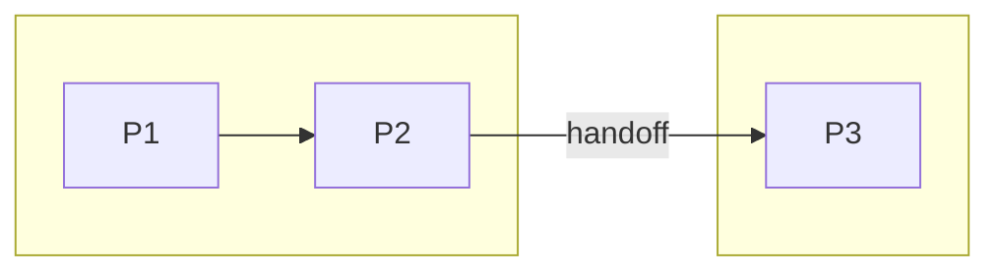
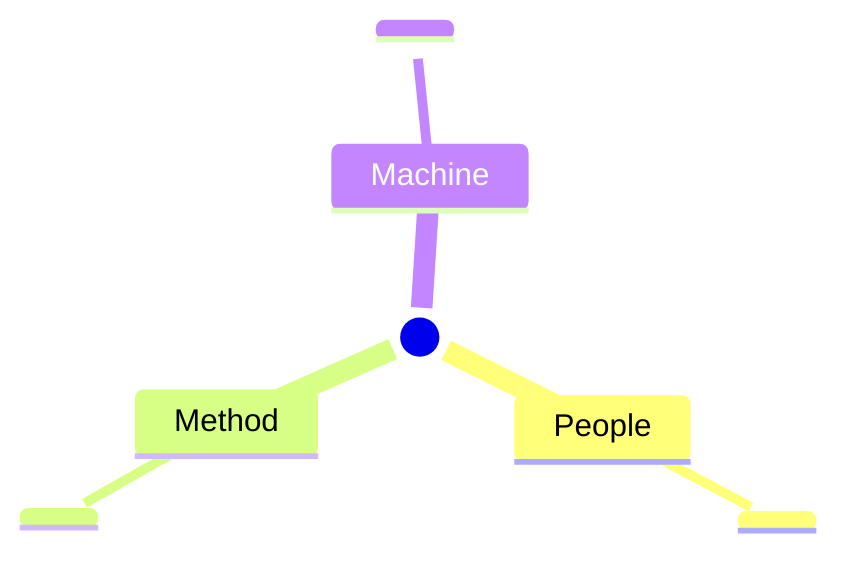
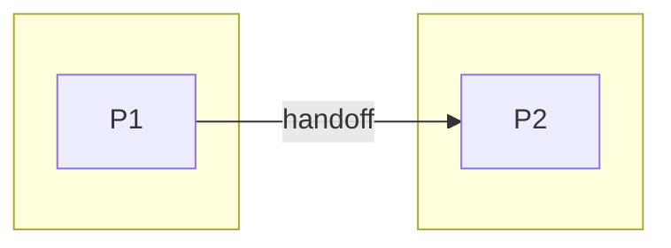

<!-- Delete any section below that does not apply. Do not fill a section with "N/A". -->
<!-- Process document: steps are P1, P2… and no BR/FR/NFR IDs appear in this file. -->

# <Process name> — Process Document

## Process summary

<Five lines or fewer: what the process produces, who triggers it, how often it runs, how
long a typical case takes, and what the requester wants changed.>

- Trigger: <event that starts the process>.
- Outcome: <what counts as finished>.
- Volume: <cases per period, or "unknown">.
- Typical duration: <time, or "unknown">.
- Source input: <transcript, ticket, email, or file path>.

## SIPOC

| Suppliers | Inputs | Process | Outputs | Customers |
|---|---|---|---|---|
| <who provides each input> | <artifact that starts the work> | <P1 … Pn, one line> | <artifact or decision produced> | <who receives each output> |

## As-is process

### Steps

| Step | Role | Activity | Input | Output | Tool / system | Wait time | Notes |
|---|---|---|---|---|---|---|---|
| P1 | <role> | <what they do> | <what arrives> | <what leaves> | <email, Excel, ERP> | <time or "unknown"> | <variation> |

### Swimlane

One `flowchart LR`, one lane per role, steps `P1…` inside their role's lane, handoffs as
labelled edges between lanes.



## Pain points

Every row starts with the `P` step where the pain occurs. `Type` is one of wait, handoff,
rework, approval, manual re-entry. `Lean waste` uses DOWNTIME.

| Step | Pain | Type | Lean waste (DOWNTIME) | Evidence | Impact |
|---|---|---|---|---|---|
| P1 | <pain> | <wait / handoff / rework / approval / manual re-entry> | <waste> | <input quote or observation> | <number, time, or "unknown"> |

## Root cause

### 5 Whys — top pain point

```
Pain: <Pn> — <pain statement>.
1. Why <effect>?            Because <cause>.
2. Why <cause>?             Because <cause>.
3. Why <cause>?             Because <cause>.
Root cause: <condition, not a person>.
```

### Fishbone — when causes branch

Replace the 5 Whys with a `mindmap` when causes run across categories; keep only categories
that have causes.



## To-be process

**Proposal — not an agreed design.**

One `flowchart LR`, one lane per role, steps inside their lane. Every change below traces to
a pain point above.

| To-be step | Change | As-is step replaced | Pain point addressed |
|---|---|---|---|
| P1 | <change> | P1 | P1 — <pain> |



## Gaps

Short version; expand into the gap-analysis template when a formal artifact is requested.

| Area | As-is | To-be | Gap | Change needed |
|---|---|---|---|---|
| <step or capability> | <today> | <proposed> | <what is missing> | <action> |

## Assumptions

| ID | Assumption | Basis in input, or impact if false |
|---|---|---|
| A-01 | <one testable statement the analysis relies on> | <input line or decision it came from, or what changes if false> |

## Open questions

| ID | Question | Owner | Blocks |
|---|---|---|---|
| Q-01 | <one answerable question> | <role or person who can answer> | <process step or gap it blocks> |
