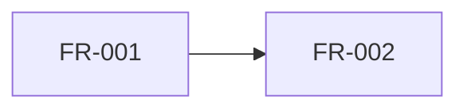

# Refund Feature Requirements

## Business Rules

- **BR-001**: A refund is allowed only within 30 days of delivery.
- **BR-002**: A refund cannot exceed the original payment amount.

## Functional Requirements

- **FR-001**: As a customer, I want to request a refund for a delivered order so that I can get my money back. Fulfils [BR-001].
- **FR-001.AC1**: Given a delivered order within 30 days, When the customer requests a refund, Then the refund is approved.
- **FR-001.AC2**: Given a delivered order older than 30 days, When the customer requests a refund, Then the refund is rejected.
- **FR-002**: As a support agent, I want to view the refund status so that I can answer customer questions. Fulfils [BR-002].
- **FR-002.AC1**: Given a refund with a status, When the agent opens the refund, Then the status is shown.
- **FR-002.AC2**: Given a refund without a status, When the agent opens the refund, Then the agent sees a pending state.

## Non-functional Requirements

| NFR-001 | 99.9 percent uptime per month |

- **NFR-001.AC1**: Given the service is running, When a month completes, Then uptime is at least 99.9 percent.

## Diagram

