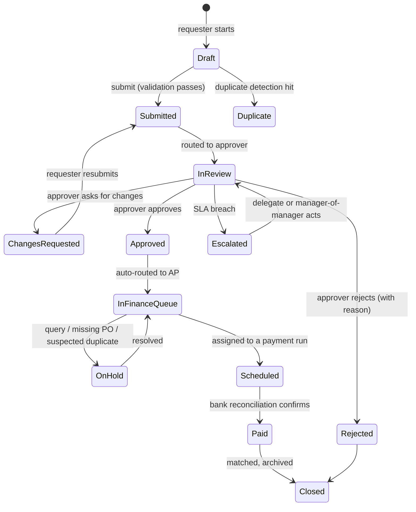

# Invoice Approval: Today vs. Better

A process map and improvement proposal for employee → manager → finance invoice
approval, currently run on email plus a shared spreadsheet.

---

## 1. Scope and players

| Role | Who | What they need from the process |
|---|---|---|
| Requester | Any employee who incurs or receives an invoice | Know it was received, approved, and paid — without chasing |
| Approver | Line manager (occasionally a second approver for large amounts) | Enough context to decide fast; someone to cover when away |
| Finance / AP | 1–2 people doing payment runs | Complete, coded, non-duplicate invoices with due dates |
| Vendor | External | Predictable payment date and a status they can check |

Out of scope for this document: procurement/PO origination, tax treatment, and bank
payment mechanics — referenced only where they constrain the design.

---

## 2. Current process (as-is)

### 2.1 What actually exists

Four systems of record, none of which reconciles with the others:

1. **The shared sheet** — one row per invoice, edited in place by everyone.
2. **Email inboxes** — manager's inbox, finance shared mailbox, employee's "sent" folder.
3. **The payment sheet** — a separate file Finance maintains, populated by copy/paste.
4. **Vendor PDFs** — loose in a network folder, attached to email, or nowhere.

An invoice's "state" is not stored anywhere. It is *inferred* from which of the four
places it last appeared in. That inference is what everyone is doing manually.

### 2.2 The flow, step by step

| # | Actor | Action | System | Resulting state (in people's heads) |
|---|---|---|---|---|
| 1 | Requester | Appends a row to the shared sheet: vendor, invoice no., amount, date, cost centre, notes | Shared sheet | "Logged" |
| 2 | Requester | Saves the PDF to the shared folder (or attaches it to the email, or neither) | File share / email | "Document somewhere" |
| 3 | Requester | Emails the manager: "please approve, row 412" | Email | "Waiting on manager" |
| 4 | Manager | Opens the email when they get to it; opens the sheet row and the PDF | Email + sheet | "In my inbox" |
| 5a | Manager | Replies "approved" / "ok" / "fine" | Email | "Approved-ish" |
| 5b | Manager | Replies "what's this for?" / "wrong cost centre" | Email | "Back with requester" — loop to step 1 |
| 6 | Manager | Forwards the approved email to Finance | Email | "With Finance" |
| 7 | Finance | Reads the shared mailbox; finds the forward; opens the sheet | Email + sheet | "In the queue (if seen)" |
| 8 | Finance | Re-types vendor, amount, due date into the payment sheet | Payment sheet | "Staged for payment" |
| 9 | Finance | Edits the shared sheet row to say "Paid" | Shared sheet | "Paid" (asserted, not verified) |
| 10 | Finance | Includes the row in the next payment run; pays | Bank / ERP | Actually paid |
| 11 | Vendor | Chases by phone/email because nothing arrived | Phone / email | "Disputed" — and nobody knows the truth |

```mermaid
flowchart LR
  E[Requester] -- "row in shared sheet\n+ email + PDF" --> M[Manager inbox]
  M -- "reply: approved?" --> E
  M -- "forward approved\n(attachment often dropped)" --> F[Finance shared mailbox]
  F -- "manual copy/paste" --> P[Payment sheet]
  F -- "edit row = Paid" --> S[Shared sheet]
  P --> RUN[Payment run]
  V[Vendor] -. "chases, gets no answer" .-> E
  V -. -> F
```

### 2.3 Where time is actually spent

Three of the eleven steps are real work. The rest is waiting or re-typing:

- **Steps 3–5: queue in one person's inbox.** No timer, no backup, no visibility.
  This is the single largest contributor to cycle time, and it is invisible until
  someone complains.
- **Step 6: the handoff is a human pressing Forward.** A forward is a copy of a copy —
  it drops attachments, splits threads, and is the step most often simply forgotten.
- **Step 8: re-keying is the only "system integration" in the process.** Every field
  typed a second time is a chance to be wrong, and errors are found by vendors, not by us.
- **Step 9: "Paid" is a claim, not an event.** The flag is set when the row is staged,
  not when the money leaves, so the sheet cannot be used to answer "was this paid?".

### 2.4 Failure modes

| Failure | Trigger | Consequence | Who feels it |
|---|---|---|---|
| **Stalled approvals** | Manager on leave, travelling, or inbox backlog | Nothing moves; invoice ages past its due date | Vendor, requester, Finance |
| **Lost handoff** | Forward not sent, sent to the wrong person, caught by a filter, thread split | Invoice never reaches Finance; discovered only when the vendor chases | Vendor, Finance |
| **Silent duplicate** | Same invoice submitted twice, by two people, or re-sent after a chase | Paid twice, or blocked and paid late while investigated | Finance |
| **Re-keying error** | Wrong amount, wrong currency, transposed digits, missing due date | Under/overpayment, late fees, cleaning up with the vendor | Finance, vendor |
| **Ambiguous approval** | "ok", "fine", approval given verbally or in a chat, or approved without opening the PDF | No defensible record of who approved what; rubber-stamping | Whole organisation (audit) |
| **No due-date ownership** | Due date never captured, or captured as the invoice date | Late payment, missed early-settlement discounts | Finance |
| **Lost change history** | Change requests live in email threads | Disputes about what was agreed; requester re-explains | Requester, manager |
| **Sheet corruption** | Anyone can edit any cell, no version control on the file | Wrong totals, deleted rows, unclear ownership | Everyone |
| **Status vacuum** | No queryable state | "Where is my invoice?" consumes the time of all three roles | Everyone |
| **Month-end scramble** | Payments batched late; no aging report | Predictable spike, predictable overtime | Finance |

### 2.5 Root causes (not symptoms)

1. **State is duplicated across four stores** and none is authoritative.
2. **Handoffs are copies** (email forwards, copy/paste), so each hop can silently lose data.
3. **Authority is not encoded** — the sheet has no notion of who may approve what,
   so approval is a social convention in an inbox rather than a rule.
4. **There is no queue owner** — an item waiting on an absent manager belongs to nobody.
5. **No timestamps** — nothing records when a step happened, so no SLA can be set,
   breached, or measured.
6. **Approval is sequential and single-threaded** — one unavailable person blocks everything,
   with no delegation path.

---

## 3. Target process (to-be)

### 3.1 Design principles

- **One record per invoice, one state field, one owner at a time.** Everything else is a view.
- **Work queues, not inboxes.** The approver's queue is a list with a count and an age.
- **Handoff = state change, not a copy.** Nothing is re-typed; nothing is forwarded.
- **Authority is a rule, not a habit.** Approver, threshold, and delegate are data.
- **Every transition is stamped and attributed.** The audit trail is a by-product of normal use.
- **Email stays as a notification channel, not a transport.** People keep their habits
  where it costs nothing; the record never lives in an inbox.

### 3.2 Invoice lifecycle



Rules:

- **Only the record's current owner can act on it.** That is what removes the "who has it?" question.
- **`Paid` can only be set by reconciliation**, never by a human asserting it.
- Every transition writes `{from, to, actor, timestamp, comment}` to an append-only log.

### 3.3 Roles and permissions

| Capability | Requester | Approver | Delegate | Finance | Admin |
|---|---|---|---|---|---|
| Create / edit own draft | ✔ | — | — | — | ✔ |
| Submit | ✔ | — | — | — | ✔ |
| Approve / reject / request changes | — | ✔ | ✔ (during delegation) | — | — |
| Change routing rules, thresholds | — | — | — | — | ✔ |
| Set cost centre / GL code | ✔ (proposed) | ✔ | ✔ | ✔ (final) | ✔ |
| Schedule payment, export run | — | — | — | ✔ | — |
| View all invoices | own only | own team | own team | all | all |

Immutability: once submitted, the invoice's core fields (vendor, number, amount) are
locked. A correction is a new revision, not an edit. This is what makes the audit trail
worth having.

### 3.4 Routing and delegation

Routing is resolved at submission, from data the requester does not control:

| Condition | Route |
|---|---|
| Amount ≤ threshold A | Line manager |
| Amount > threshold A, ≤ B | Line manager, then Finance director (parallel or sequential — pick one) |
| Amount > B | Above, plus procurement/project owner |
| Cost centre has a designated budget owner | That owner is added as approver |
| Approver is on leave with an active delegation | Delegate receives it, approver is CC'd |
| Approver on leave, no delegation | Auto-escalate after 1 business day to their manager |
| Approver inactive 2 business days (any reason) | Escalate; notify approver and requester |

Delegation is explicit and time-boxed: *"from 3–14 Nov, approve for me"* is a record,
not a favour. This single feature removes the most common stall in the current process.

### 3.5 Finance workflow

- **Approved queue sorted by due date**, not by arrival. Aging is visible by default.
- **Due date is mandatory and validated at submission** (default: invoice date + payment terms,
  overridable with a reason). This is what stops late payment.
- **Duplicate detection at intake**: exact match on (vendor, invoice number), fuzzy match on
  (vendor, amount ±2%, date window). A hit routes to `Duplicate`/`OnHold` — never to payment.
- **Three-way match where a PO exists**: PO ↔ invoice ↔ receipt. Auto-approve clean matches
  below a threshold; exceptions go to a human queue.
- **Payment run as an export, not a re-key**: generate the bank file from the queue,
  then reconcile back. `Paid` is set by the reconciliation import, so the sheet's
  "asserted paid" problem disappears.
- **Batch by payment date**, with a cutoff. Vendors get a scheduled date at approval time.

### 3.6 Intake: how invoices get in

Two channels, both creating a draft record rather than an email:

1. **Dedicated AP address** (`invoices@`) — inbound mail creates a draft, the PDF is
   attached to the record, and basic fields are extracted (vendor, number, amount, date)
   for the requester to confirm. Requires no behaviour change from employees, which is
   why it should come first.
2. **Portal form** — for employees who raise an invoice themselves. Validate at the boundary:
   vendor, invoice number, amount, currency, date, due date, cost centre, PDF.
   Reject incomplete submissions there, not in Finance's mailbox.

### 3.7 Vendor-facing status

An automated acknowledgement on receipt ("received 14 Nov, in review") and a status
query — either a public status page keyed by invoice number, or a templated reply from
`ap@`. This removes the majority of chase calls without giving vendors access to anything
they should not see.

### 3.8 Notification design

- Approver: one notification per invoice assigned, plus a daily digest and an escalation nudge.
- Requester: notified on approve / reject / change request / payment date set / paid.
- Finance: notified on new approved items; a morning digest of overdue and on-hold.
- All notifications link to the record. No notification is the only copy of anything.

---

## 4. Mapping: pain → fix → measure

| Current pain | Change | Metric that proves it worked |
|---|---|---|
| Approval stalls when manager is away | Explicit delegation + escalation timer | % invoices first-actioned within 1 business day |
| Finance misses a forward | Handoff is a state change; no email forwarding | Invoices approved but never actioned by AP: target 0 |
| Duplicate payments | Intake-time duplicate detection | Duplicate payment count: target 0 |
| Re-keying errors | Single record; payment run exported, not typed | Payment exceptions per run |
| Ambiguous approvals | Role-based action with reason codes and audit log | % approvals with complete attribution (target 100%) |
| Late payment / missed discounts | Mandatory due date; queue ordered by due date | % paid on or before due date; discounts captured |
| "Where is my invoice?" | Queryable state + vendor acknowledgement | Status enquiries per 100 invoices |
| Month-end crunch | Daily queue + scheduled payment dates | Cycle-time variance across the month |
| No accountability | Append-only transition log | Audit findings: target 0 |

---

## 5. Rollout

Do not replace everything at once. Each phase is independently useful.

**Phase 0 — baseline (2 weeks).** Measure the current process: volume, median and
90th-percentile submit→approved and approved→paid, count of chase emails, count of
duplicates found. Without this, no improvement claim is verifiable. Cheap: a timestamp
column and a manual weekly tally.

**Phase 1 — one record, one state.** Stand up the workflow tool with intake (AP address
or form), the lifecycle states, and role-based views. Keep email notifications so nobody
has to learn a new habit. The shared sheet becomes read-only or is retired. *Exit
criterion:* every new invoice exists in exactly one place.

**Phase 2 — routing and timers.** Thresholds, delegation, escalation, SLA clocks,
approver queues. *Exit criterion:* the delegate path is used at least once per leave
period and nothing stalls silently.

**Phase 3 — finance automation.** Due-date validation, duplicate detection, payment-run
export, reconciliation import that sets `Paid`. *Exit criterion:* zero manual re-keying
of approved invoices; `Paid` is only ever reconciliation-driven.

**Phase 4 — vendor and insight.** Acknowledgement, status lookup, dashboards for cycle
time and aging, exception reporting. *Exit criterion:* status enquiries drop measurably
against the Phase 0 baseline.

Build vs. buy: at this scale, a low-code workflow tool or the AP module of an existing
accounting system is almost certainly cheaper than custom software. The requirements above
are the evaluation checklist — the differentiators are **delegation, escalation timers,
duplicate detection, and a reconciliation-driven `Paid` state**. Many tools ship the first
two and get the last one wrong.

---

## 6. Risks and open questions

| Risk / question | Why it matters |
|---|---|
| Invoice volume per month? | Decides buy vs. build, and whether payment runs are weekly or daily |
| Are there POs? | Determines whether three-way match is possible or the process stays two-way |
| Multi-currency and VAT handling | Changes the validation rules and the payment-run export |
| Who owns the routing matrix? | If it is configurable by an admin, it will drift; needs a named owner |
| Record retention and data-protection rules | Invoices contain vendor banking data; audit and retention periods must be set |
| Vendor banking-detail changes | Fraud vector — any change to bank details needs a separate, out-of-band verification step |
| Existing accounting/ERP system | If one exists, it should hold the canonical payment state, not the new tool |
| Email as a legal record | Some jurisdictions accept email approvals; confirm before retiring them |

---

## 7. One-paragraph summary

Today an invoice lives in four places at once — a shared sheet, three inboxes, a payment
sheet, and a folder of PDFs — and its status is inferred rather than recorded. Work moves by
forwarding copies, so the two handoffs that matter most (requester → manager, manager →
finance) are also the two that fail silently, and the single approver is a hard bottleneck
whenever they are away. The fix is not a better spreadsheet: it is one record per invoice
with an explicit state, an owner, timestamps, rules for who may approve what, a time-boxed
delegation path, an escalation clock, and a payment step that is reconciled rather than
asserted. Email survives as notifications. Everything else moves to a queue.
