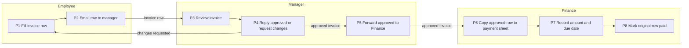
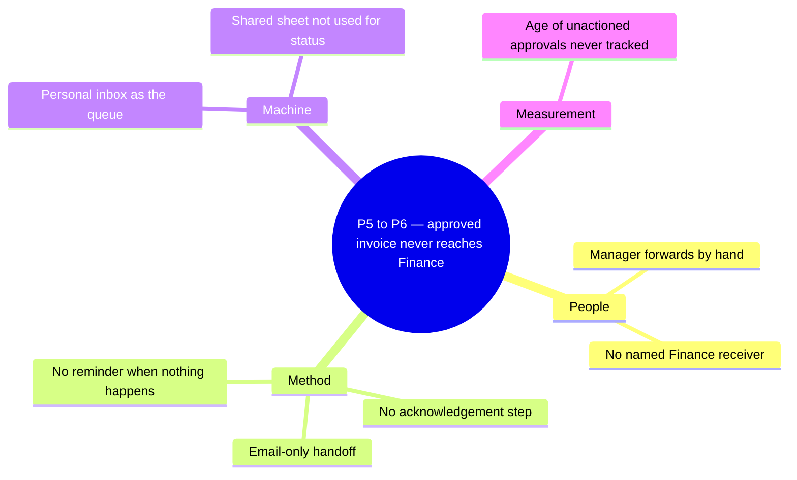
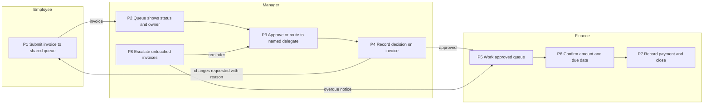

<!-- Process document: steps are P1, P2… No BR/FR/NFR IDs appear in this file. -->

# Invoice Approval and Payment — Process Document

## Process summary

Employee raises an invoice row in a shared sheet and emails it; manager approves by reply
and forwards to Finance; Finance copies it into a payment sheet and marks the original row
paid. The process produces a scheduled payment and a closed invoice row. Trigger is the
employee receiving an invoice to pay; the requester wants the stalls (manager on leave,
missed Finance email) removed.

- Trigger: an invoice arrives that the employee needs paid.
- Outcome: the invoice is paid and both the shared sheet row and the payment sheet agree.
- Volume: assumed about 40 invoices per month across three roles (A-09).
- Typical duration: assumed 8–12 working days from invoice arrival to paid row (A-10).
- Source input: written description of current practice supplied by the requester
  (no transcript, ticket, or file). No further detail was available, so every number
  below is a marked assumption (A-nn), not an observed fact.

## SIPOC

| Suppliers | Inputs | Process | Outputs | Customers |
|---|---|---|---|---|
| Vendor; Employee | Invoice (paper/PDF), invoice row in shared sheet | P1 Fill invoice row · P2 Email row to manager · P3 Manager reviews · P4 Reply approved or request changes · P5 Forward to Finance · P6 Copy row to payment sheet · P7 Record amount and due date · P8 Mark original row paid | Approved invoice; payment-sheet entry with amount and due date; paid row | Manager; Finance; vendor; auditor (see Q-01) |

## As-is process

### Steps

| Step | Role | Activity | Input | Output | Tool / system | Wait time | Notes |
|---|---|---|---|---|---|---|---|
| P1 | Employee | Fills one invoice row in the shared sheet | Invoice details from vendor | New row in shared sheet | Excel (shared sheet) | under 1 day, assumed (A-10) | Row quality depends on the employee; no stated check at entry |
| P2 | Employee | Emails the row to their manager | Row reference / sheet | Email to manager | Email | under 1 day, assumed (A-10) | Same data is entered in the sheet and repeated in the email |
| P3 | Manager | Reviews the invoice | Email, shared sheet | Decision | Email + Excel | 1–3 days; the whole leave period when the manager is away, assumed (A-10) | Single approver, no stated delegate |
| P4 | Manager | Replies "approved" or asks for changes | Email | Reply email | Email | under 1 day, assumed (A-10) | Decision lives in a mail thread, not the sheet |
| P5 | Manager | Forwards approved invoices to Finance | Approved email | Email to Finance | Email | under 1 day, assumed (A-10) | One more copy of the same decision |
| P6 | Finance | Copies approved rows into the payment sheet | Finance inbox, shared sheet | Payment-sheet rows | Excel + email | 1–5 days; unbounded when the email is missed, assumed (A-10) | Manual re-entry of fields already in the shared sheet |
| P7 | Finance | Records amount and due date | Payment-sheet row | Dated, valued payment line | Excel (payment sheet) | under 1 day, assumed (A-10) | Due date source not stated — see A-04 |
| P8 | Finance | Marks the original row paid | Payment confirmation | Paid row in shared sheet | Excel | 1–3 days after payment, assumed (A-10) | Second sheet touched; the two can drift apart |

### Swimlane



## Pain points

| Step | Pain | Type | Lean waste (DOWNTIME) | Evidence | Impact |
|---|---|---|---|---|---|
| P3 | Case cannot move while the manager is away; no named stand-in | wait | Waiting | "Sometimes the manager is on leave and nothing moves" | Every in-flight case waits the full leave; at the assumed 40 invoices/month (A-09) that is several cases per leave |
| P5 → P6 | Approval sits in one person's inbox; Finance has no shared queue | handoff | Inventory | "sometimes Finance misses an email and a vendor chases us" | Unprocessed approvals accumulate; vendor escalation per missed case, assumed a few per month (A-09) |
| P3 → P4 | Approval decision recorded in a mail reply, not on the invoice itself | approval | Extra-processing | "replies 'approved' or asks for changes" | Status must be re-read from mail; no single place shows where a case stands |
| P4 → P1 | Changes requested send the case back for the row to be reworked | rework | Defects | "asks for changes" | Every rejection costs one extra loop through P1–P4 |
| P1 → P2 | Same data entered in the sheet and repeated in the email | manual re-entry | Over-production | "fills in an invoice row in the shared sheet and emails it" | Duplicate effort per invoice; sheet and mail can disagree |
| P6 | Approved fields copied by hand into the payment sheet | manual re-entry | Defects | "Finance copies the approved rows into a payment sheet" | Keying differences between shared sheet and payment sheet |
| P8 | Paid state updated in a second place | manual re-entry | Motion | "marks the original row paid" | Two records to keep in step; see A-06 |
| P3 | Every invoice, at any amount, needs the same single approver | approval | Extra-processing | Approval described as one manager for all invoices; no threshold stated — working rule in A-11 | Manager queue grows with small-value items |

Ranked by impact: P3 (blocked case), then P5 → P6 (missed handoff), then P4 → P1 (rework).

## Root cause

### 5 Whys — top pain point

```
Pain: P3 — a case waits days whenever the manager is on leave.
1. Why does the case wait?             Because only the manager can approve it.
2. Why can only the manager approve?   Because approval is personal, not attached to a role with cover.
3. Why is there no cover?              Because the approval step is a personal email reply, with no delegation rule.
4. Why is there no delegation rule?    Because the approval process was never written down.
5. Why was it never written down?      Because the process grew ad hoc around email and a shared sheet.
Root cause: no written approval policy that names who may approve when the usual approver is unavailable.
```

### Fishbone — missed Finance handoff



## To-be process

**Proposal — not an agreed design.**

Same three lanes, so the comparison is role by role. Numbering is new, not a mapping of
old numbers. "Queue" below means a work practice — one shared list everyone can see, which
a status column on the existing sheet would satisfy. Choosing or building a tool is outside
this document.

| To-be step | Change | As-is step replaced | Pain point addressed |
|---|---|---|---|
| P1 | Invoice submitted once, to one shared queue that all three roles can see; no duplicate email | P1, P2 | P1 → P2 — manual re-entry |
| P2 | Queue shows each invoice with a status and an owner | P3, P4 | P3 → P4 — decision only in mail |
| P3 | Approval goes to the manager, and automatically to a named delegate when the manager is unavailable; a single approver is enough up to the working limit in A-11 | P3 | P3 — manager on leave; P3 — one approver for every amount |
| P4 | Decision is recorded against the invoice, not in a reply; "changes requested" sends it back to the submitter with the reason | P4 | P4 → P1 — rework without reason |
| P5 | Finance works from the same approved queue, not from personal mail; approved invoices are visible without being forwarded | P5, P6 | P5 → P6 — missed handoff |
| P6 | Amount and due date are captured at approval, so Finance does not re-key them | P6, P7 | P6 — manual re-entry |
| P7 | Payment is recorded once and closes the invoice in the shared queue | P8 | P8 — second record to keep in step |
| P8 | Any invoice untouched beyond the working age limit in A-13 is escalated to the delegate and to Finance | (new) | P3 — silent stall; P5 → P6 — vendor chase |



## Gaps

| Area | As-is | To-be | Gap | Change needed |
|---|---|---|---|---|
| Intake | Row in sheet plus email to manager | One submission, one queue | Second copy of every invoice | Stop emailing rows; make the queue the record |
| Approval cover | Only the manager approves; leave stops the case | Named delegate, automatic | No delegation rule, no named deputy | Write an approval policy naming delegates |
| Approval evidence | Approval lives in an email reply | Decision recorded against the invoice | No single place shows a case's status | Record the decision where the invoice is |
| Finance handoff | Manager forwards; Finance may miss it | Finance works the approved queue | No shared queue, no acknowledgement | Make the approved queue Finance's intake |
| Data entry | Amounts and due dates keyed at P6/P7 | Captured once at approval | Duplicate keying, two sheets that can drift | Capture amount and due date once |
| Escalation | Nothing happens when a case stalls | Time-based escalation to delegate and Finance | No timer, no owner of the timer | Adopt the working age limit (A-13) and name the person who watches it |
| Measurement | No counts stated | Case age and count visible | No metric today | Agree the number the business judges this by (A-09, A-10) |

## Suggested sequencing

Order of business changes if the to-be is adopted. Each row is a change the business can
make without buying anything; each is only worth doing once its prerequisite is fixed.

| Order | Change | Prerequisite | Why this order |
|---|---|---|---|
| 1 | Name a delegate per manager and accept delegate approval | None — a written decision | Removes the top-ranked pain (P3) with no new data or tooling |
| 2 | Add status and owner to the shared sheet row; stop emailing invoice details | Order 1, so approvals have somewhere to land | Kills the duplicate entry at P1 → P2 and the "where is my invoice" question |
| 3 | Finance takes approved invoices from the sheet, not the inbox | Order 2 | Removes the missed handoff at P5 → P6; needs no acknowledgement email |
| 4 | Capture amount and due date at approval; close the row on payment | Order 2 and 3 | Removes the double keying at P6 and the drift noted in A-06 |
| 5 | Run the 5-day escalation clock (A-13) with a named owner | Orders 1–3; confirm A-11 and A-13 first | Only makes sense once status and delegate exist — otherwise there is nothing to escalate |

## Assumptions

| ID | Assumption | Basis in input, or impact if false |
|---|---|---|
| A-01 | One shared workbook holds both the invoice rows and the Finance payment sheet, or two workbooks in the same place. | "shared Excel sheet" and "payment sheet" both described as sheets; if separate systems, P8 needs a reconciliation step. |
| A-02 | One invoice equals one row, and invoice identity is carried by that row. | "fills in an invoice row", "copies the approved rows"; if one row can batch many invoices, P6 and P8 split per invoice. |
| A-03 | The manager's approval is binary — approved, or changes requested. | "replies 'approved' or asks for changes"; a third outcome (reject outright) would add a path. |
| A-04 | Due date comes from the vendor's invoice terms and is entered by Finance. | Input says Finance "records the amount and due date" without naming the source; if due date is negotiated, P7 gains a step. |
| A-05 | Email is the only notification channel today; the shared sheet sends nothing. | All handoffs described as emails; if sheet alerts exist, P5 → P6 pain is smaller than stated. |
| A-06 | Payment execution (bank transfer, accounting entry) happens outside this process; the payment sheet only schedules it. | Input stops at "records the amount and due date"; if payment runs from the sheet, P7 needs an execution and confirmation step. |
| A-07 | Volume is low enough that a single shared queue is workable without prioritisation rules. | Three-role process around one sheet; if the real volume is far above A-09, the to-be needs triage rules. |
| A-08 | Case duration is counted from submission to payment, not from invoice date. | Not stated; if measured from invoice date, overdue reporting changes. |
| A-09 | Volume is about 40 invoices per month, spread evenly across the week, with no seasonal peak. | No figure supplied. If the real volume is much higher, the queue needs prioritisation and the to-be P8 escalation needs a full-time owner. |
| A-10 | A typical case takes 8–12 working days: about 2 at the manager, 1–5 waiting for Finance to notice the email, and the rest queued for the payment run. | Derived from the described handoffs, not observed. If the real cycle is shorter, the P3 and P5 → P6 pain impacts shrink proportionally. |
| A-11 | A single approver is enough below 10,000 in the local currency; at or above that, a second approver is required. | No threshold given. The number is a placeholder to make the to-be testable; if wrong, only the routing rule in to-be P3 changes, not the process shape. |
| A-12 | Cover today is informal: someone else in the manager's team may approve, but only if asked by email, and Finance does not accept it as a rule. | "Sometimes the manager is on leave and nothing moves" implies no reliable cover. If expected cover already exists in writing, the root cause is an adoption problem, not a missing policy. |
| A-13 | An invoice untouched for 5 working days is escalated; Finance owns watching that clock. | Chosen to fit inside the A-10 cycle. If the business wants a different age limit, only the escalation trigger changes. |
| A-14 | A disputed invoice stays in the queue with status "disputed" and an owner, and returns to approval once resolved. | No dispute path was described. If disputes are handled outside the process, to-be P4 loses the disputed state. |

## Open questions

Only one item genuinely needs an answer from outside this analysis — a retention rule cannot be reasonably assumed, because getting it wrong has compliance consequences.

| ID | Question | Owner | Blocks |
|---|---|---|---|
| Q-01 | Is approval evidence (who approved, when, at what amount) required for audit, and for how long must it be kept? | Finance / auditor | P4, P7; SIPOC customer list |
